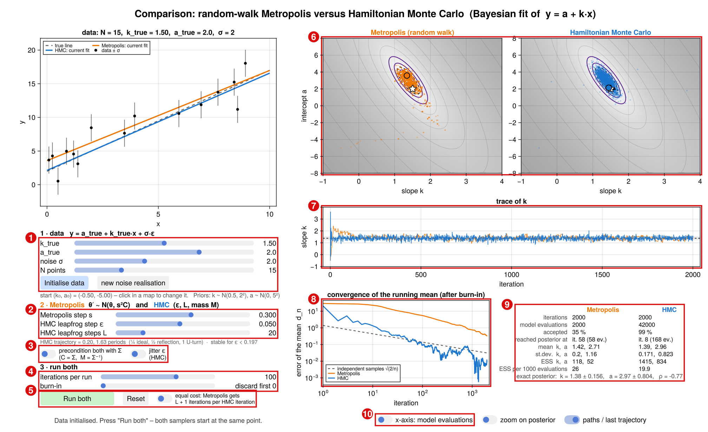
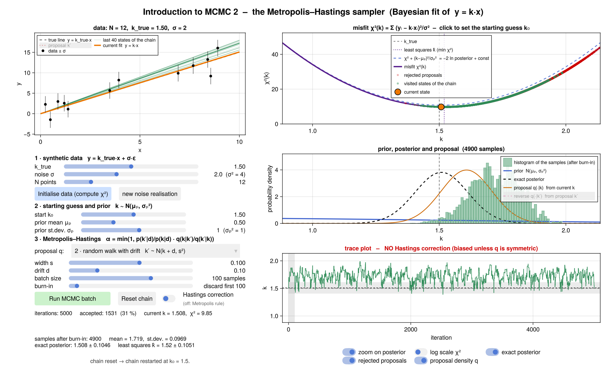
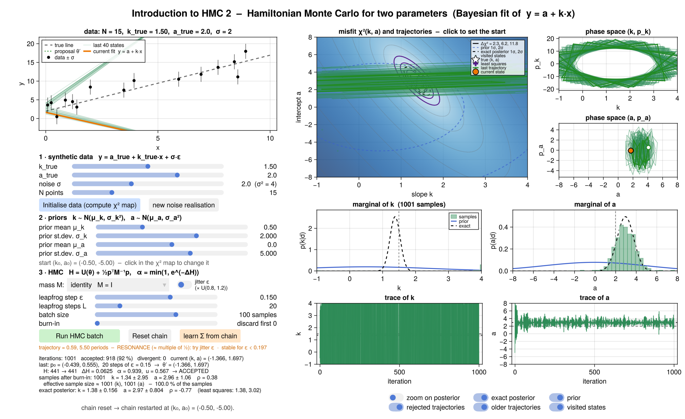

# Bayesian inversion with MCMC and HMC in Julia

Seven interactive Julia programs that let you watch Markov chain Monte Carlo samplers at work on the simplest
inverse problem there is: fitting a straight line (or a polynomial) to noisy data. You generate the data
yourself, so the exact posterior is always known, and you can see when a sampler converges, how fast it gets
there, and when it is wrong.

The programs cover the Metropolis algorithm, Metropolis–Hastings (with the Hastings correction switchable on and
off), Hamiltonian Monte Carlo (HMC), and two side-by-side comparisons of Metropolis and HMC, the second one for
up to ten parameters.

📄 **The full guide is in [guide/guide.pdf](guide/guide.pdf).** It covers the theory (Bayes' theorem, why the
evidence cancels in the acceptance ratio, leapfrog dynamics, resonances, preconditioning) and walks through every
program with annotated screenshots and exercises.



## The programs

| # | File | Model | Sampler |
|---|------|-------|---------|
| 1 | [Introduction_MCMC_1.jl](Introduction_MCMC_1.jl) | $y = kx$ | Metropolis (random walk) |
| 2 | [Introduction_MCMC_2.jl](Introduction_MCMC_2.jl) | $y = kx$ | Metropolis–Hastings: four proposals (random walk, drift, independence, MALA), Hastings correction on/off |
| 3 | [Introduction_MCMC_3.jl](Introduction_MCMC_3.jl) | $y = a + kx$ | Metropolis–Hastings in 2-D, learned proposal covariance |
| 4 | [Introduction_HMC_1.jl](Introduction_HMC_1.jl) | $y = kx$ | Hamiltonian Monte Carlo, with the phase space $(k, p)$ |
| 5 | [Introduction_HMC_2.jl](Introduction_HMC_2.jl) | $y = a + kx$ | HMC in 2-D: mass matrix, step-size jitter, resonances |
| 6 | [Comparison_MCMC_to_HMC_1.jl](Comparison_MCMC_to_HMC_1.jl) | $y = a + kx$ | Metropolis and HMC side by side, compared per iteration and per model evaluation |
| 7 | [Comparison_MCMC_to_HMC_2.jl](Comparison_MCMC_to_HMC_2.jl) | polynomial, $D = 1 \dots 10$ | both side by side, with a scan of efficiency against the number of parameters |

## Installation

1. Install a recent Julia from <https://julialang.org/downloads/>. The recommended installer is *juliaup*: on
   Windows install *Julia* from the Microsoft Store, on macOS/Linux run

   ```sh
   curl -fsSL https://install.julialang.org | sh
   ```

   The programs were developed with Julia 1.13.

2. Clone this repository:

   ```sh
   git clone https://github.com/evmoulas/Hamiltonians.git
   cd Hamiltonians
   ```

3. Install the packages listed in `Project.toml` (GLMakie, LinearAlgebra, Printf, Random):

   ```sh
   julia --project=. -e "using Pkg; Pkg.instantiate()"
   ```

   This downloads and precompiles GLMakie and takes a few minutes the first time.

## Running a program

From a terminal in the repository folder:

```sh
julia Introduction_MCMC_1.jl
```

or from the Julia REPL:

```julia
include("Introduction_MCMC_1.jl")
```

Every program activates its own environment (`Pkg.activate(@__DIR__)`), so you don't need to start Julia with
`--project`. A window opens; when started from a terminal, the program keeps running until the window is closed.

> [!NOTE]
> The first start of a Julia session is slow (about 30–60 s to load and compile GLMakie). If you start Julia once
> and `include` the programs one after another from the REPL, you only pay this once.

### The interface

All programs share the same layout: the **data** in the upper left, the **controls** below it, the **misfit**
(or misfit map) in the upper right, and the **posterior and trace plots** in the lower right.

- **Data sliders** (true parameters, noise σ, number of points N) only take effect when you press
  **Initialise data**.
- Changing the **prior** or the **starting point** restarts the chain. A left click in the misfit panel or map
  sets the starting point.
- **Run** adds a batch of 1, 10, 100 or 1000 iterations. With a batch of 1, the last step is explained in detail:
  the proposal, the acceptance probability α, and the random number u that decided.
- **burn-in** sets how many initial iterations are left out of the statistics.

Colours are consistent across the programs: data black, true values grey dashed, current state orange, visited
states and sample histogram green, rejected proposals red, prior blue, exact posterior black dashed.

## What you can explore

<table>
<tr>
<td width="50%"></td>
<td width="50%"></td>
</tr>
<tr>
<td><b>Program 2:</b> switch the Hastings correction off with an asymmetric proposal and the histogram shifts
away from the exact posterior, while the trace still looks fine.</td>
<td><b>Program 5:</b> an HMC resonance. The trajectory length is a multiple of half a period of the stiff
direction, and the chain swings across the whole valley. Jittering ε fixes it.</td>
</tr>
</table>

- **Step size** (Program 1): too small and the chain crawls; too large and it stands still.
- **Correlated parameters** (Programs 3, 5): the slope and intercept of a line are strongly anti-correlated.
  Learning the posterior covariance from a pilot run speeds up both Metropolis and HMC.
- **HMC trajectory length** (Program 4): a quarter period gives nearly independent samples, half a period
  reflects, a full period is a U-turn, and too large a step makes the leapfrog integrator diverge.
- **Who converges faster?** (Programs 6, 7): per iteration HMC wins by a large factor. Per model evaluation,
  the two are similar with two parameters, but the gap grows with dimension: Metropolis loses roughly a
  factor 1/D and HMC only D<sup>−1/4</sup>. At D = 10, HMC is already 4–7 times more efficient in the best
  case, and much more on a badly conditioned problem.

## Repository layout

```
Introduction_MCMC_{1,2,3}.jl     Programs 1–3 (Metropolis, Metropolis–Hastings)
Introduction_HMC_{1,2}.jl        Programs 4–5 (Hamiltonian Monte Carlo)
Comparison_MCMC_to_HMC_{1,2}.jl  Programs 6–7 (side-by-side comparisons)
Project.toml                     Julia package dependencies
guide/
  guide.pdf                      the guide
  guide.tex                      LaTeX source of the guide
  figures/                       annotated screenshots used in the guide
  make_screenshots.jl            regenerates the screenshots
```

To rebuild the screenshots in `guide/figures`:

```sh
julia guide/make_screenshots.jl all     # every program, each in its own process
julia guide/make_screenshots.jl hmc1    # one of: mcmc1, mcmc2, mcmc3, hmc1, hmc2, cmp, cmp2
```

## Troubleshooting

- **No window opens / OpenGL error:** GLMakie needs a graphics card with OpenGL 3.3. It won't work on a remote
  machine without a display.
- **The data sliders have no effect:** press **Initialise data**.
- **The window is too small:** the data panel shrinks first and the controls always stay visible. Below about
  1280×680 pixels the layout gets cramped.
- **The histogram doesn't match the exact posterior:** not enough samples, burn-in not removed, the Hastings
  correction switched off (Programs 2, 3), or an HMC resonance or U-turn (Programs 4–7).
- **The scan in Program 7 takes a few seconds:** it runs 2 × 10 × 30 chains (about 10 s with a budget of
  10<sup>5</sup> evaluations).

## Further reading

- Neal, R. M. (2011). MCMC using Hamiltonian dynamics. In *Handbook of Markov Chain Monte Carlo*, CRC Press, 113–162.
- Betancourt, M. (2017). A conceptual introduction to Hamiltonian Monte Carlo. [arXiv:1701.02434](https://arxiv.org/abs/1701.02434).
- Hoffman, M. D., Gelman, A. (2014). The No-U-Turn Sampler. *Journal of Machine Learning Research* 15, 1593–1623.
- Mosegaard, K., Tarantola, A. (1995). Monte Carlo sampling of solutions to inverse problems. *Journal of
  Geophysical Research* 100, 12431–12447.
- Tarantola, A. (2005). *Inverse Problem Theory and Methods for Model Parameter Estimation*. SIAM.

The guide lists the complete references.

## Author

Evangelos Moulas (made using Claude). Guide version 1.0, 15 Nov 2026.
